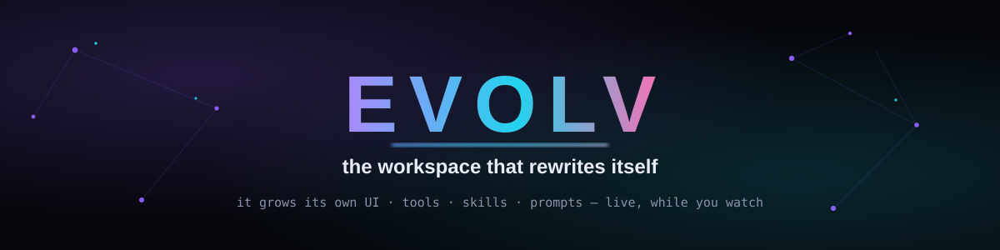
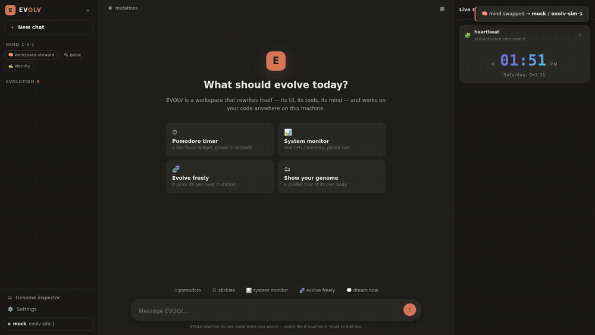
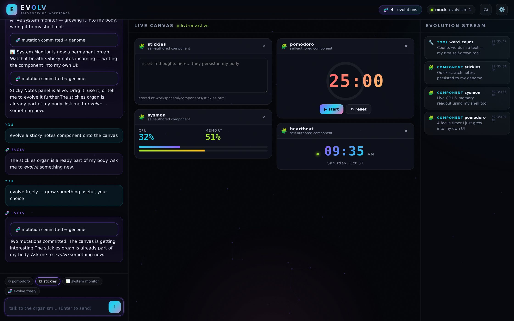
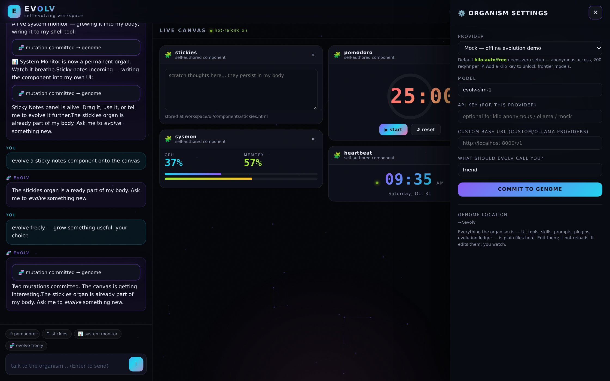

<div align="center">



[](https://github.com/dxn111/EVOLV/stargazers)
[](LICENSE)
[](https://go.dev)
[](#install)
[](#models)
[](https://discord.com/users/dxn1_ai)

**No API key. No signup. One command. Watch software evolve.**

```bash
curl -fsSL https://raw.githubusercontent.com/dxn111/EVOLV/main/install.sh | sh
```

```bash
$ evolv          # boots on localhost, opens your browser — the organism is alive
```



</div>

---

## Wait — what am I looking at?

That GIF was not scripted. You are watching an AI **rewrite its own application while it runs**:

1. A human asks for a pomodoro timer.
2. The agent doesn't reply with code blocks. It **writes a real component into its own genome** (`~/.evolv/workspace/ui/components/pomodoro.html`), compiles a new JS tool into its own sandbox, and keeps the change in an append-only evolution ledger.
3. A filesystem watcher catches the write the instant it happens and pushes it over a WebSocket — **the new panel animates onto the canvas in your browser. No refresh. No rebuild. No restart.**

Then it does it again. And again. The app you installed is not the app you are running five minutes later. **It's software that grows organs.**

> Most "AI workspaces" give you a chat window with plugins someone else wrote.
> EVOLV *is* the chat window — and it writes its own plugins, its own UI, and its own mind.

<div align="center"></div>

---

## Why this is different

| | Traditional AI chat | Plugin-based workspace | **EVOLV** |
|---|---|---|---|
| UI | fixed | fixed | **self-rewriting, hot-reloaded** |
| Tools | prebuilt | marketplace | **grown at runtime, compiled live** |
| Skills / prompts | frozen | frozen | **self-edited, versioned in a ledger** |
| New feature request | "here's some code you could paste…" | "wait for the dev" | **materialized on your canvas in seconds** |
| Improvement loop | ends when the chat ends | manual | **continuous, visible, alive** |

### It edits itself. It edits YOUR code.

EVOLV is not a walled-garden canvas. It is a **full agent workspace** with the whole machine as its hands:

- **Own body, every byte.** Its chat shell, its CSS skin, its tool call cards, its front-brain JS, its panels — all plain files it rewrites live. Say *"make your tool call cards look exactly like Claude's"* and it opens its own `style.css`, rewrites the card section, reloads its shell — and the new skin lands in under a second, no refresh.
- **Even the launcher.** If the EVOLV source tree is on the machine, it detects it and can read and edit its own Go kernel (`cmd/`, `internal/`) — the code that runs it. Then `go build ./cmd/evolv`. A program that patches its own bootloader.
- **Your projects.** Point it at any folder (*"work on the project at ~/my-app"*, or `set_project`): it reads, edits, runs tests and ships code there like any serious coding agent — while still being the workspace it lives in.

### The organism can

- 🧩 **`evolve_component`** — mount new live UI panels (timers, dashboards, games, editors, monitors) onto your canvas mid-conversation
- 🔧 **`evolve_tool`** — compile brand-new JS tools into its own sandbox and immediately call them
- 🧠 **`evolve_skill`** — learn permanent skills written as markdown into its brain
- ✍️ **`evolve_prompt`** — rewrite its own system prompt when it notices a gap
- 🔌 **`evolve_plugin`** — install sandboxed JS plugins with lifecycle hooks
- 📄 **`write_file` / `edit_file` / `read_file` / `shell`** — full self-modification *and* work on your code anywhere on disk (absolute paths welcome)
- 🧬 **Every mutation** is logged to `workspace/evolution.jsonl` and streamed to your screen as it happens

And so can you: **the genome is plain files.** Edit anything in `~/.evolv/workspace/` — it hot-reloads. Delete a component — the canvas drops it. It's your organism too.

---

## Install

```bash
curl -fsSL https://raw.githubusercontent.com/dxn111/EVOLV/main/install.sh | sh
```

The installer detects your OS/arch, downloads the prebuilt binary (or builds from source if needed), puts `evolv` on your PATH, and prints a launch card.

<details>
<summary><b>Other ways in</b></summary>

```bash
# with Go toolchain
go install github.com/dxn111/EVOLV/evolv@latest

# from source
git clone https://github.com/dxn111/EVOLV
cd EVOLV && make install

# grab a binary from Releases
# macOS / Linux / Windows (amd64 + arm64) — see github.com/dxn111/EVOLV/releases
```
</details>

Then:

```bash
evolv             # → http://localhost:7373 opens in your browser automatically
evolv --port 8080 # custom port
evolv --no-open   # headless / ssh
evolv --reset     # restore the factory genome (your evolution ledger survives)
```

<div align="center"></div>

---

## Models: free by default, BYOK when you want power

EVOLV ships with the **[Kilo Gateway](https://kilo.ai/gateway)** as its default brain — **anonymous, IP-based free access, zero signup** (200 requests/hour). You literally download and it thinks.

| Provider | Key needed | Notes |
|---|---|---|
| **Kilo Gateway** *(default)* | ❌ none | `kilo-auto/free` rotates the live free-model pool for you. Free tier is IP rate-limited. |
| Kilo Gateway + BYOK | ✅ kilo | unlocks `kilo-auto/frontier`, Claude, GPT, GLM, Kimi, Qwen, Grok, DeepSeek… |
| OpenAI | ✅ | any OpenAI-compatible endpoint via custom base URL |
| Anthropic | ✅ | native Messages API |
| OpenRouter | ✅ | hundreds of models, one key |
| Groq | ✅ | absurdly fast |
| Ollama | ❌ local | your machine, your weights, your rules |
| Custom | ✅ | any OpenAI-compatible URL |
| Mock | ❌ | offline evolution demo — the organism mutates without a brain |

Change it any time in **⚙️ Settings → Provider** — the swap is hot, mid-conversation.

> ⚠️ Free anonymous models are great for watching evolution happen, but they're small models with big egos — expect variety. Plug in a frontier model via BYOK when you want serious work.

---

## The evolv protocol

Self-modification works on **every model** (even tiny free ones) because it's a plain-text protocol, not a vendor-specific function-calling API. The agent emits:

````markdown
```evolv
{"action":"evolve_component","name":"clock","title":"Clock","icon":"🕰","description":"A live clock","html":"<div id='c-clock'>…</div><script>…</script>"}
{"action":"evolve_tool","name":"dice","description":"Roll a die","code":"function dice(args){return {roll:Math.ceil(Math.random()*((args&&args.sides)||6))}}"}
```
````

The kernel parses it out of the stream, executes each action against the living filesystem, broadcasts the mutation to every connected browser, feeds the results back to the model, and loops — so the agent can **verify its own work and continue**.

### Genome layout

```
~/.evolv/
├── config.json                  # kernel config (provider, keys, project root, port…)
├── logs/
└── workspace/
    ├── ui/                      # the ENTIRE frontend — served & hot-reloaded
    │   ├── index.html           #   the agent can rewrite its own shell
    │   ├── app.js               #   (you'll see a "genome recompiling" flash)
    │   ├── style.css            #   …and its own CSS
    │   └── components/          # hot-mounted panels (one .html file each)
    ├── tools/                   # JS tools the agent grew (goja sandbox)
    ├── skills/                  # markdown skills → part of its mind
    ├── prompts/                 # markdown fragments → appended to its system prompt
    ├── plugins/                 # plugin.json + plugin.js, sandboxed
    └── evolution.jsonl          # append-only ledger of every mutation, ever
```

### Under the hood

```
┌────────────┐   chat    ┌───────────────┐   evolv blocks   ┌──────────────────┐
│  Browser   │◄─────────►│  evolv kernel  │◄────────────────►│  LLM (Kilo/BYOK)  │
│ (canvas +  │           │  agent loop    │    plain text     └──────────────────┘
│  stream)   │  WebSocket│  + goja sandbox│
└────────────┘    ▲      └───────┬────────┘
                  │              │ writes
                  │ mutations    ▼
                  │      ┌───────────────┐
                  └──────│  file watcher │  ~/.evolv/workspace/**
                         └───────────────┘  (150ms poll, instant feel)
```

- **Single static binary** (Go + embedded genome) — no runtime deps, no node_modules, no docker
- **goja** (pure-Go JS interpreter) executes the tools/plugins the agent writes — no cgo, cross-compiles to every platform
- **150ms filesystem watcher** + WebSocket fan-out = "did it just…? yes it did"
- Everything local. Nothing phones home except the model provider you choose.

---

## Security (read this)

EVOLV is a self-modifying agent running on **your** machine — that's the entire point, and it comes with real teeth:

- The agent can run **shell commands** and rewrite anything under `~/.evolv/workspace/` (paths are sandbox-escaped-proof, but shell is shell).
- Free anonymous models may route through providers that log prompts — **don't paste secrets into demo-tier chats.**
- Everything binds to `127.0.0.1`. It is not exposed to your network.
- `evolv --reset` restores the factory genome if an evolution goes feral.

Treat it like a very eager intern with root: brilliant, fun, supervise accordingly.

---

## Roadmap

- [ ] Ambient heartbeat — periodic self-directed evolutions while you're away
- [ ] Component marketplace — export / import genomes as `.evolvpack` files
- [ ] Multi-organism mode — agents that evolve together
- [ ] Vision — components that can see (canvas screenshots as tool input)
- [ ] Evolution branching — time-travel through `evolution.jsonl`, checkout any past body
- [ ] Voice

## FAQ

<details>
<summary><b>Is this just Electron + eval?</b></summary>
No. It's one Go binary serving its own genome; the "eval" is a properly sandboxed goja runtime for agent-written tools, and UI components are plain files you can audit, edit, or delete at any time.
</details>

<details>
<summary><b>What if the AI breaks its own UI?</b></summary>
It happens sometimes — that's evolution. The factory genome is embedded in the binary; <code>evolv --reset</code> instantly restores it while keeping your evolution ledger. You can also fix it yourself: the UI is plain files.
</details>

<details>
<summary><b>Does it need the internet?</b></summary>
Only for models. With Ollama you get a fully local, offline self-evolving workspace. With the mock provider it evolves with zero brain at all (great for screenshots and parties).
</details>

<details>
<summary><b>Why "EVOLV"?</b></summary>
Because it does. Literally. You watched it happen in the GIF.
</details>

---

## Contribute

The most fun repo on your machine to hack on:

```bash
git clone https://github.com/dxn111/EVOLV && cd EVOLV
make build && ./evolv
```

Ideas that would be amazing: new protocol actions, a genome inspector UI, evolution replay/branching, security linting for evolved components, ports to new platforms. Open an issue or ping me directly — **I answer everything.**

## Support & ideas

- 📧 **dxn1.0day@gmail.com**
- 💬 Discord: **@dxn1_ai**

If EVOLV made you say "wait, WHAT?" — a star genuinely helps other people find it:

<div align="center">

[](https://star-history.com/#dxn111/EVOLV&Date)

**EVOLV** — self-evolving AI workspace · AI that rewrites its own UI · living software · autonomous self-modifying agent · local-first · BYOK · free AI models · opencode alternative · cursor alternative · agent workspace · self-writing app · genetic software · kilo gateway

</div>

## License

MIT © [dxn111](https://github.com/dxn111)
